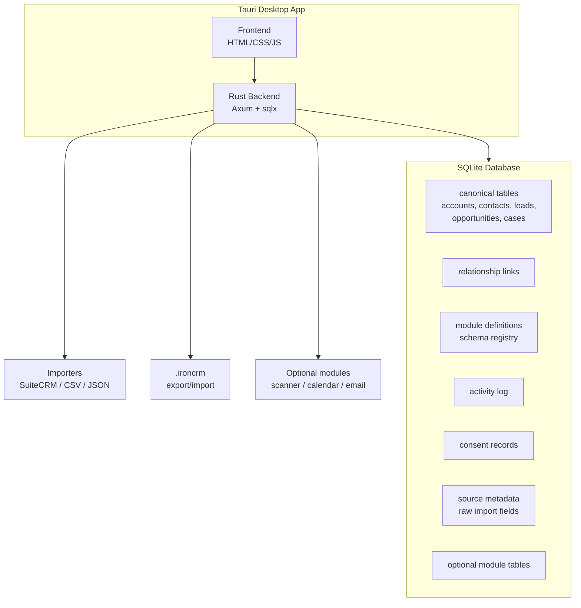

# White Warren PRD - The Portable CRM

**Status:** Draft v2
**Product:** White Warren (The Portable CRM)
**Author:** Rati
**Date:** 2026-06-07

---

## 1. Executive Summary

White Warren is a local-first desktop CRM for small businesses that makes customer data portable by default. It is built for people who want the practical benefits of a CRM without surrendering their customer relationships to a hosted vendor, opaque export buttons, or per-seat SaaS pricing.

The core promise is simple:

> **Your CRM data comes out whole: records, relationships, custom fields, notes, consent evidence, and schema.**

Most CRMs treat export as a compliance checkbox. White Warren treats export as a product feature. A complete `.ironcrm` bundle can be restored into a fresh White Warren instance and inspected without vendor permission. Over time, that bundle format should become an open portability spec that other tools can implement.

White Warren monetizes trust: a business that knows it can leave is a business that can confidently choose to stay.

## 2. Problem Statement

### For traditional SMBs

Switching CRMs is painful because exports are lossy. Businesses often lose relationship history, custom field definitions, pipeline stages, record links, and activity context. Migration projects can cost thousands of dollars in services and cleanup.

This is especially painful for small operators who do not have technical staff and cannot justify enterprise migration budgets.

### For SuiteCRM users

SuiteCRM users chose control and low cost, but many now carry the burden of PHP hosting, MySQL maintenance, aging plugins, and manual backups. They have valuable CRM data, but the path from a self-hosted SuiteCRM instance to a simpler desktop CRM is unclear.

### For regulated and privacy-sensitive work

Lawyers, therapists, accountants, doctors, consultants, and local service businesses often need to know why a contact is stored, what data exists, and how to respond to access or deletion requests. Existing CRMs either bury this workflow or require trusting a cloud vendor.

### For White Warren specifically

The current product is a proof-of-concept: a SuiteCRM-compatible local viewer with early module definitions, import plumbing, and scanner scaffolding. The next product step is not more novelty. It is a reliable daily CRM loop:

1. import or create data,
2. manage it locally,
3. preserve relationships and notes,
4. export it completely,
5. restore it somewhere clean.

## 3. Target Users

### Primary: Small business owners and solo teams, 1-25 employees

Examples: consultants, boutique agencies, local service businesses, insurance agents, real estate teams, bookkeepers, and independent sales teams.

What they share:

- They currently use spreadsheets, SuiteCRM, or a free/cheap SaaS CRM.
- They care about ownership but do not want to administer a server.
- They dislike per-seat pricing.
- They have been burned by migration or fear being trapped later.
- They need contacts, accounts, opportunities, notes, and search more than enterprise automation.

### Secondary: SuiteCRM escapees

Organizations that adopted SuiteCRM for cost/control reasons, have accumulated years of data and custom fields, and want to leave the PHP/MySQL maintenance burden without losing context.

### Tertiary: Privacy-sensitive professionals

Professionals who prefer or require local storage: therapists, attorneys, accountants, small clinics, and compliance-conscious consultants.

## 4. Value Proposition

> **Never lose your customer data again. Manage relationships locally. Export everything in one complete, restorable bundle.**

| Pillar | What it means |
|--------|---------------|
| **Complete portability** | Export records, schema, custom fields, relationships, activities, consent evidence, and metadata together. |
| **Local-first control** | Data lives on the user's machine in SQLite. No account signup, no cloud dependency, no sync latency. |
| **Daily CRM basics** | Accounts, contacts, opportunities, leads, cases, relationships, notes, search, and simple pipeline views. |
| **Migration-friendly** | SuiteCRM and CSV imports map into White Warren's canonical model while preserving source metadata. |
| **Consent-aware** | Consent/legal-basis records are first-class CRM data and included in exports. |
| **Extensible modules** | Optional modules can add scanners, calendar, email, invoicing, and other workflows without bloating core v1. |

## 5. Competitive Landscape

| Competitor | Lock-in mechanism | Portability story | Local-first |
|------------|-------------------|-------------------|-------------|
| Salesforce | Custom objects, workflows, integrations, admin dependency | CSV/API export plus paid migration services | No |
| HubSpot | Free-tier gravity, marketing/email ecosystem, rate limits | API/CSV export with relationship loss risk | No |
| Zoho CRM | App suite integration, custom modules | CSV per module | No |
| SuiteCRM | Self-hosted PHP/MySQL, plugin and schema drift | Database dump, DIY migration | Kind of |
| Airtable/Notion | Flexible schema with weak CRM semantics | CSV/JSON export, limited CRM reconstruction | No |
| Spreadsheets | No app lock-in, but weak relationships/history | File portability, poor CRM semantics | Yes |
| **White Warren** | **None by design** | **Complete `.ironcrm` bundle with data, schema, links, notes, and consent evidence** | **Yes** |

## 6. Product Principles

1. **Data outlasts the tool.** CRM data should remain meaningful after it leaves the app.
2. **Export is a core workflow.** Export must be complete, one-click, documented, and regularly tested by round-trip restore.
3. **Local-first before networked.** The product must be useful with no account, no server, and no internet connection.
4. **Boring CRM beats clever infrastructure.** Contacts, accounts, notes, search, and pipeline management must work before advanced identity, sync, or AI features.
5. **Consent is operational, not ornamental.** Users should know which contacts have consent/legal-basis evidence, what is expiring, and what can be exported for an audit.
6. **Technical complexity stays below the UX.** Users should see "portable record," "complete export," and "consent record," not DIDs, VCs, hashes, or schemas unless they ask.
7. **Modules extend the core.** Scanner, calendar, email, social, and document features should be modules that feed the same canonical schema and export format.

## 7. Functional Scope

### 7.1 Core CRM v1

| Feature | Detail |
|---------|--------|
| Accounts | CRUD, primary contact info, address, industry/type, custom fields. |
| Contacts | CRUD, name, title, primary phone/email, account linkage, custom fields. |
| Opportunities | CRUD, amount, stage, probability, close date, account/contact links, kanban board. |
| Leads | CRUD, status, source, conversion path into account/contact/opportunity. |
| Cases | CRUD, priority, status, resolution, account/contact links. |
| Relationships | First-class links between core records, navigable from detail views and preserved in export. |
| Activity log | Append-only notes and timeline events per record. Field-level signatures are deferred. |
| Search | Full-text or pragmatic indexed search across core modules and notes. |
| Custom fields | Source custom fields and user-defined fields are stored in canonical custom field containers and exported with schema. |

### 7.2 Import and canonical schema v1

| Feature | Detail |
|---------|--------|
| Canonical model | White Warren-native structs for core modules with simple primary fields plus overflow/custom fields. |
| SuiteCRM import | Map SuiteCRM tables and custom fields into the canonical model while retaining source IDs and metadata. |
| CSV import | Column detection and mapping flow for contacts/accounts/opportunities. |
| Generic JSON import | Import records from a documented JSON shape that includes module/schema metadata. |
| Source preservation | Imported records retain source system, source module, source ID, import timestamp, and raw/original fields where useful. |

### 7.3 Portable bundle v1

| Feature | Detail |
|---------|--------|
| `.ironcrm` export | A single archive containing manifest, records, schemas, custom field definitions, relationships, activities, consent records, and source metadata. |
| Round-trip restore | A bundle exported from White Warren can initialize a fresh White Warren database with equivalent records and relationships. |
| Versioned manifest | Bundle declares format version, app version, generated time, module list, counts, and feature flags. |
| Integrity checks | Bundle includes hashes/checksums so restores can detect corruption or tampering. Cryptographic signing is deferred. |
| Open spec | The bundle shape is documented enough for future converters/importers. |

### 7.4 Consent and audit v1

| Feature | Detail |
|---------|--------|
| Consent/legal basis record | Per-contact record containing legal basis, scope/purpose, evidence note, source, issued date, and optional expiry. |
| Consent badge | Contact detail shows missing, valid, expiring, or expired consent status. |
| Expiry dashboard | List contacts with expiring/missing consent evidence. |
| Record export | Export a contact with related account, opportunities/cases, activities, and consent evidence. |

Notes:

- v1 should be designed to support GDPR/CCPA workflows but should avoid overclaiming legal compliance.
- W3C Verifiable Credentials and signed receipts are useful later, but plain structured consent records are sufficient for the first product loop.

### 7.5 Stable identity v1/v2 boundary

White Warren needs stable portable record identifiers, but v1 does not require every record to own a cryptographic key.

Recommended model:

- every record gets an immutable White Warren portable ID on creation/import,
- imported records preserve external/source IDs,
- each workspace has a local signing identity reserved for future signed exports and consent receipts,
- DID/VC support is deferred until after bundle round-trip and consent UX are proven.

Future DID support can wrap the stable ID model without forcing cryptographic concepts into early UX.

### 7.6 Optional scanner module, not core v1

The scanner is an optional module that feeds data into the same import/mapping pipeline as CSV, SuiteCRM, and JSON. It is not a core dependency for v1.

| Feature | Detail |
|---------|--------|
| Business card scanner | Optional module: image/webcam input to suggested contact/account fields. |
| Document scanner | Optional/experimental module: invoice/contract extraction to opportunity or activity drafts. |
| Local inference | Prefer local inference; model download/bundling should be optional because large models increase install size and support burden. |
| Human confirmation | Scanner output always creates drafts that users confirm before save. |

### 7.7 Deferred v2+

- Signed export bundles.
- W3C Verifiable Credential consent receipts.
- DID-based workspace or record identity.
- CRDT/multi-device sync.
- Email/calendar integrations.
- Scanner module polish and model distribution.
- Plugin/module SDK.
- IPFS/Arweave/off-site encrypted archives.
- Web companion and mobile companion.

## 8. User Journeys

### Journey A: New business starts locally

1. Ana runs a boutique PR agency and downloads White Warren.
2. On first launch, she chooses: create manually, import CSV, or import from SuiteCRM.
3. She imports a CSV of 80 media contacts. White Warren detects columns, lets her map them, and stores records with stable portable IDs.
4. She opens a contact. The detail view shows fields, account link, activity timeline, and a consent badge: "No consent recorded."
5. She records "Legitimate interest - journalist outreach - expires in 2 years."
6. She creates an opportunity linked to that contact and account.
7. She exports a `.ironcrm` bundle as a backup. No account signup or cloud sync is required.

### Journey B: SuiteCRM migration

1. Marcus runs a manufacturing rep firm on SuiteCRM with years of accounts, contacts, custom fields, and opportunities.
2. He points White Warren at his SuiteCRM MySQL database or exported dump.
3. White Warren maps SuiteCRM modules into its canonical records and stores unmapped fields as custom/source metadata.
4. Relationship tables are reconstructed as White Warren links.
5. Marcus opens White Warren and sees usable accounts, contacts, opportunities, notes, and pipeline stages.
6. He exports a `.ironcrm` bundle and restores it into a fresh local database to verify the migration.

### Journey C: Regulatory/audit request

1. Dr. Chen receives a subject access request.
2. She searches for the client in White Warren.
3. The contact detail shows fields, related cases/activities, and consent/legal-basis evidence.
4. She clicks "Export record." White Warren produces a structured JSON/archive containing the contact, related records, activities, and consent evidence.
5. The request is resolved from local data without waiting on a SaaS vendor.

### Journey D: Switching away from White Warren

1. Priya has used White Warren for two years and decides to move elsewhere.
2. She clicks "Export all."
3. White Warren produces a `.ironcrm` bundle containing records, module schemas, custom fields, relationships, activity log, consent records, and manifest.
4. A converter or compliant CRM imports the bundle.
5. Her migration does not depend on hidden APIs, vendor permission, or manual CSV stitching.

### Journey E: Optional scanner module at a conference

1. James enables the scanner module before a trade show.
2. He photographs a business card.
3. The scanner suggests contact/account fields.
4. James confirms or edits the draft.
5. The created records are ordinary White Warren records and are included in exports like everything else.

## 9. Architecture

### Architectural notes

- The canonical schema should be White Warren-native, not merely SuiteCRM tables copied forward.
- External systems map into canonical records through import adapters.
- Optional modules must write ordinary records, relationships, activities, or module-specific tables that the bundle format can describe.
- Export/import round-trip tests are part of product correctness, not a nice-to-have.

## 10. Success Metrics

| Metric | v1 Target | Rationale |
|--------|-----------|-----------|
| Time to first contact | < 30 seconds | Walk-up users must see value immediately. |
| SuiteCRM core import success | > 95% for accounts/contacts/opportunities and key relationships | Migration is the beachhead. |
| CSV import completion | < 5 minutes for a typical 500-row contact CSV | Spreadsheet users need low friction. |
| Bundle round-trip completeness | 100% for records, relationships, schema, custom fields, activities, consent records | This is the product promise. |
| App startup time | < 2 seconds | Desktop-native expectation. |
| Memory usage | < 150 MB without optional modules | Tauri/Rust advantage over Electron. |
| Consent visibility | 100% of contacts show missing/valid/expired status | Makes audit workflows operational. |

## 11. Risks and Open Questions

| Risk / Question | Mitigation / Direction |
|-----------------|------------------------|
| "Portable CRM" sounds like a feature, not a purchase driver. | Lead with concrete pain: never lose data, leave HubSpot/SuiteCRM safely, complete backup/restore. |
| Core CRM quality is overshadowed by DID/AI novelty. | Keep v1 focused on CRUD, relationships, notes, import, export, restore. |
| Canonical schema conflicts with SuiteCRM compatibility. | Preserve source metadata while mapping into a simpler White Warren-native model. |
| Consent features create legal overclaiming. | Say "supports audit/portability workflows" rather than promising compliance. |
| Export format becomes undocumented internal backup. | Publish a versioned manifest and maintain round-trip/converter tests. |
| Local-only limits collaboration. | Accept solo/small-team beachhead; defer sync. |
| Scanner model is too heavy. | Ship scanner as optional module/download, not a default v1 dependency. |
| Cryptographic identity complexity leaks into UX. | Begin with stable record IDs and workspace identity; defer DID/VC UI and signing. |

## 12. Milestones

| Milestone | Scope | Outcome |
|-----------|-------|---------|
| **M1 - Foundation** | SuiteCRM import proof-of-concept, local viewer, module definitions, scanner scaffold | Existing proof-of-concept established. |
| **M2 - Daily CRM Loop** | CRUD for core modules, relationships, notes/activity log, search, kanban for opportunities | Usable as a local CRM for a solo operator. |
| **M3 - Canonical Import Layer** | SuiteCRM mapping, CSV import, JSON import, source metadata preservation, custom fields | External data lands in a stable White Warren model. |
| **M4 - Portable Bundle MVP** | `.ironcrm` export/import, manifest, schema, relationships, activities, consent records, hash checks | The portability promise is demonstrable by round-trip restore. |
| **M5 - Consent and Audit UX** | Consent badges, legal-basis records, expiry dashboard, per-record audit export | Privacy-sensitive users can answer data/consent questions quickly. |
| **M6 - Launch Hardening** | Packaging, migration guide, docs, onboarding, sample data, backup/restore tests | Public release candidate. |
| **M7 - Optional Modules** | Scanner module, calendar/email experiments, plugin/module boundaries | Extension without bloating core CRM. |
